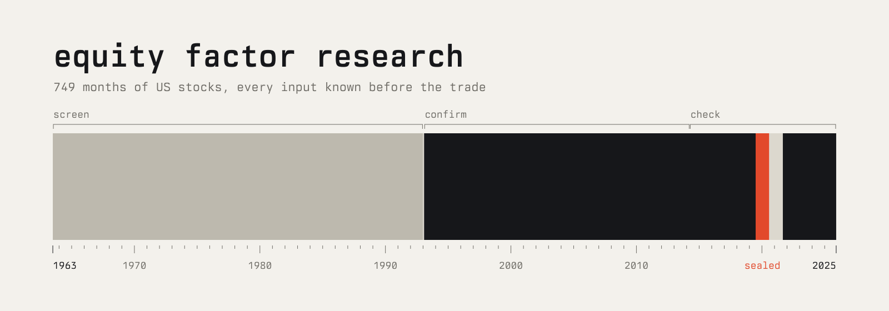
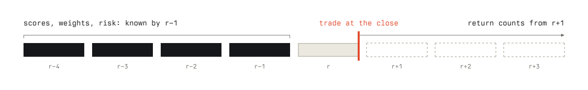
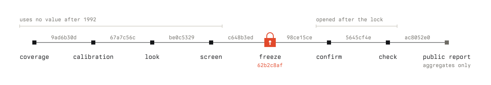
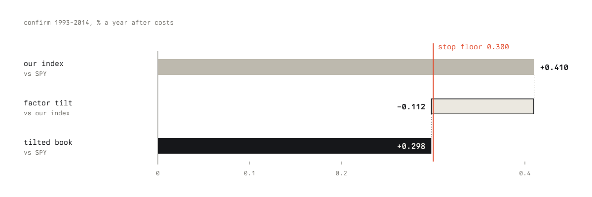
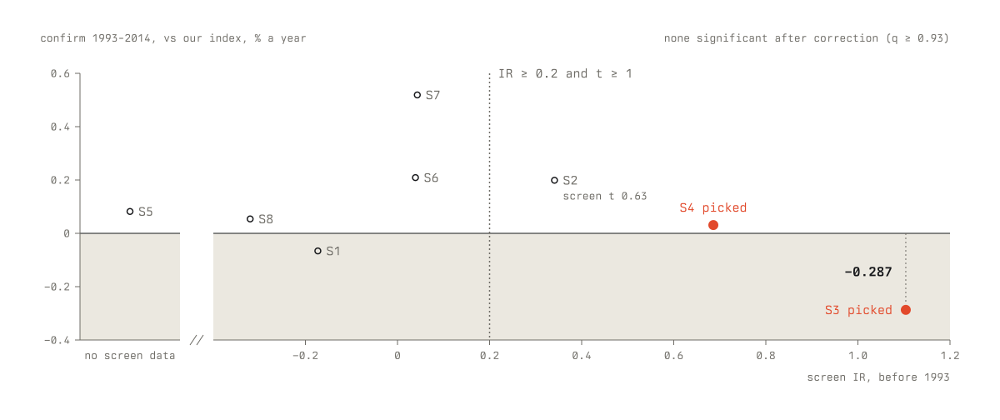
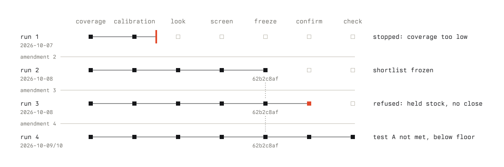
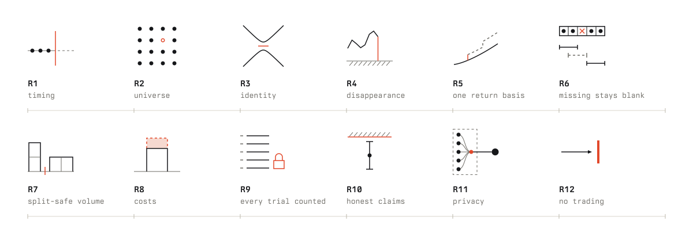
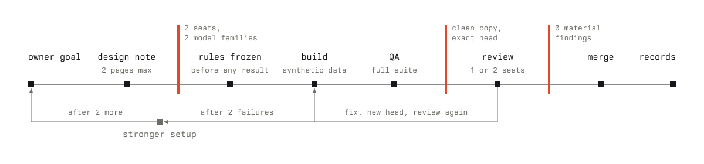

<picture>
  <source media="(prefers-color-scheme: dark)" srcset="assets/readme/hero-dark.svg">
  
</picture>

<p>
  <a href="https://github.com/minqiyang/equity-factor-research/actions/workflows/ci.yml"></a>
  
  <a href="LICENSE"></a>
  
  
</p>

Can a simple stock-selection rule beat an S&P 500 index fund (SPY) after trading costs, using only what was known at the time?

This repository is a research lab for that question. It tests factor rules on 62 years of US stock data in simulation. A factor is a stock trait, such as profitability or past return, that a rule uses to rank stocks. Each decision uses only data dated before its trade, and company accounts keep their first-reported values.

The method is the point. Each choice that could flatter a result is fixed in writing before that result exists, and code and tests enforce it. The last trial ran end to end under those rules and stopped at its pre-set floor. With the current data and these factors, we found no reliable edge (owner decision O-23).

## Design at a glance

- **Point-in-time universe.** S&P 500 members as they were on each day from 1963 to 2025, from CRSP, with every firm that later failed or was bought.
- **Known before the trade.** Each input enters on the day it became known. Tests rewrite the future and check that every past decision stays the same.
- **Rules before results.** A frozen trial file fixed the periods, the tests, a stop floor, and a sealed year before any return was computed.
- **A hash-chained run.** Seven stages, each locked to every earlier stage by SHA-256. The shortlist is locked before the code parses a single test-period quote.
- **Two benchmarks at once.** The tilt must beat SPY and our own copy of the index, so a win has to come from the factors.
- **Real costs.** A dated cost schedule, a floor at the real CRSP half-spread in the test periods, and every result again at twice the cost.
- **Every run on the record.** Failed and refused runs stay in the ledger, and Holm and Benjamini-Yekutieli corrections cover every tested variant of the trial.
- **Built by AI agents under review.** Real-data code gets reviewers from two model families, and CI runs 4,117 tests.

## How a result is earned

### One rule about time

<picture>
  <source media="(prefers-color-scheme: dark)" srcset="assets/readme/timing-dark.svg">
  
</picture>

Call the last trading day of each month `r`. The model reads data up to the trading day before, `r-1`. It trades at the close of `r`, and its return starts on the next trading day, `r+1`. The repository names this contract `after_close_signal_next_observed_close_v1`.

Each layer of the code, from the data loader to the run driver, has a test that rewrites the future and checks that every earlier decision stays the same. Each of these tests also proves that it can fail. In the engine, the same random change made one day earlier moves the result.

### Three periods and a sealed year

The band at the top is every month of the study, 749 months from 1963-07 to 2025-11. The split was fixed before this study computed any return.

- **Screen**, 1963-07 to 1992-12, 354 months. Picks candidates.
- **Confirm**, 1993-02 to 2014-03, 254 months. Tests the frozen shortlist.
- **Check**, 2014-04 to 2025-11, 114 months. A last look that can only veto. It steps around the sealed year and a warm-up after it, 2019-07 to 2021-08.
- **Sealed**, 2019-07-31 to 2020-07-31. Its price and return rows live in a separate folder. The loader refuses to open it and only takes a SHA-256 fingerprint of those files.

### A run that cannot go out of order

<picture>
  <source media="(prefers-color-scheme: dark)" srcset="assets/readme/chain-dark.svg">
  
</picture>

Each stage writes its file once, with its SHA-256 fingerprint, and starts only when every earlier file matches. The freeze stage locks the shortlist with a fingerprint. Confirm and check take that fingerprint as a separate input and must match it before the code parses a single test-period quote.

## What we found

The last trial (Milestone 5.5) was an index tilt. It starts from our own copy of the S&P 500, built from the members known on each date. Each stock holds its cap weight, which is its share of the total market value. The pictures call this our index, and the reports call it CW-PIT, for cap-weighted point-in-time. The tilt moves each weight `b` a little toward stocks with a good factor score `c` between -1 and 1, as `w = b(1 + 0.5c)`. Each weight moves at most 1 percentage point, and the expected tracking error against our index stays at or below 2% a year.

<picture>
  <source media="(prefers-color-scheme: dark)" srcset="assets/readme/verdict-dark.svg">
  
</picture>

| Confirm, 1993-2014, % a year after costs | Primary cost | 2x cost |
| --- | ---: | ---: |
| Tilted book vs SPY | +0.298 | -0.053 |
| Tilted book vs our index | -0.112 | -0.313 |
| Our index vs SPY | +0.410 | +0.260 |

The tilted book beat SPY by 0.298% a year, under the stop floor of 0.300% that was fixed before any return. The line stopped where the plan said it would.

The table also shows where the lead came from. Our index beat SPY by 0.410% a year. The report calls that gap replication error, with sources such as SPY's fee, full against float market value, and members dropped for missing data. The tilt itself lost 0.112% a year against our index.

Test A was built for this case. The tilt had to beat SPY and our index at the same time, which is an intersection-union test, so a win has to come from the factors. It got t = 1.04 against SPY and t = -0.51 against our index, for p = 0.6944 against a Holm threshold of 0.025.

<picture>
  <source media="(prefers-color-scheme: dark)" srcset="assets/readme/screen-dark.svg">
  
</picture>

The screen picked two signals out of eight. S3 is the stock's return minus the market's over the three trading days around its latest earnings announcement. S4 is gross profit over assets. In the confirm years S3 trailed our index by 0.287% a year. The strongest signal against our index was S7, net share issuance, which the screen had passed over. Across the nine secondary runs its q-value is 0.934.

The plan sized test A in advance with a power analysis at 2% tracking error. The tilt ran at 0.86% against our index, so the test saw smaller edges than planned, even on the 154 months left after price gaps. Milestone 5, a factor-class allocator that moved weight between groups of factors, reached the same answer before it. The [method page](docs/research_method.md) has the full history.

## Every run on the record

<picture>
  <source media="(prefers-color-scheme: dark)" srcset="assets/readme/ledger-dark.svg">
  
</picture>

Run 1 stopped on low coverage. Run 3 met a case the plan had already named, a held stock leaving with no closing price, and refused before it wrote a confirm file. Amendment 4 added the fix, and runs 3 and 4 rebuilt the run 2 shortlist with the same fingerprint.

<picture>
  <source media="(prefers-color-scheme: dark)" srcset="assets/readme/guards-dark.svg">
  
</picture>

Twelve research-safety rules, R1 to R12 in [AGENTS.md](AGENTS.md), run through every layer. Code and tests enforce most of them, and reviews cover the rest.

<details>
<summary><b>Design notes for quants</b></summary>

- **Universe.** S&P 500 members as they were on each day, from CRSP, with firms that later left, failed, or were bought. A stock is eligible at row `t` when `start <= t < end`.
- **Identity.** Every stock is keyed by its CRSP PERMNO, so each return path belongs to one security (PIT-005). An ambiguous Compustat or IBES link blanks the values it would feed, with the reason `ambiguous_link`.
- **First-reported fundamentals.** Each Compustat item is its first published value, usable from the trading row after the day it became known.
- **Disappearance.** A held stock that leaves settles at its real exit return when the data has one. Otherwise a cash merger settles at its last close, and a failure or an unknown cause at -100%. In the confirm run, 302 of 303 held exits had a real return. Every run is repeated with every exit at its last close, and a sign flip between the two labels the result fragile. The composite kept its sign.
- **Costs.** One-way commission and spread in bp, on a dated schedule. Screen months pay 30 + 30 before 1975-05 and 10 + 30 after. Confirm and check months pay 5 + 20 from 1993, 2 + 8 from 2001-04, and 1 + 4 from 2007, and each trade pays the larger of the schedule spread and the real CRSP half-spread from the day before. Our index pays the same rule. Every case also runs at 2x cost.
- **Missing data.** Every blank signal cell stays blank and carries one of 13 named reasons. A stock with too few valid signals or an incomplete risk window keeps its index weight. A held stock across a price gap blanks every month it touches, in every book, which is 215 screen months and 100 confirm months.
- **Multiple testing.** Two primary tests under Holm at 0.05, so test A needed p ≤ 0.025 even after test B, a lower-risk book, stopped on low data coverage. Nine secondary runs carry Benjamini-Yekutieli q-values. The 481 test slots of Milestone 5 stay on the record.
- **Blind benchmark gap.** Our index against SPY stayed unopened until the confirm run, because that gap is one leg of test A.
- **Cost rule before cost data.** The spread rule was committed before the quote data was downloaded.
- **Fixes are checked too.** The first draft of the fix after run 3 had a look-ahead. It set an exit event only if no close came back before the segment end. A review seat caught it, and a check over 18,600 history pairs found 159 differences for that draft and 0 for the final fix.
- **Privacy by arithmetic.** Each published weight is a sum over at least 3 positions, and any two published sums differ by at least 3 positions, so every difference still mixes several licensed rows.

</details>

## How the code is built

<picture>
  <source media="(prefers-color-scheme: dark)" srcset="assets/readme/process-dark.svg">
  
</picture>

AI agents write and review most of the code under the owner's written rules, and the owner sets goals, money, and data access. Agents build and test on synthetic data. Real-data code that computes signals, returns, identity, costs, or statistics gets two reviewers from different model families, and other code gets one. Each merge lands on the exact commit that was reviewed, with every material finding fixed or ruled on by the owner.

CI runs the 4,117-test suite in four parallel lanes, then checks that the tests left every tracked file unchanged. Other tests keep this repository in English, keep private paths out of it, and pin six phrases on this page to the real scope.

## Run it

Python 3.11 or newer is required.

```bash
git clone https://github.com/minqiyang/equity-factor-research.git
cd equity-factor-research
python3.11 -m venv .venv
source .venv/bin/activate
python -m pip install -e ".[dev]"
python -m pytest -q
python -m research.demo_v0
```

`demo_v0` runs 12-1 momentum on a synthetic panel with a fixed seed. It rewrites `reports/demo_v0.md` and appends to `reports/demo_v0_attempts.jsonl`, so `git status` shows them as changed.

The public research path uses local files and committed fixtures. The real-data runs use licensed WRDS data and an earlier EODHD snapshot. The repository publishes their code, frozen rules, data manifests, hashes, and aggregate reports.

## Where things are

| Path | What it holds |
| --- | --- |
| `src/` | Data contracts, factors, the backtest engine, risk, reporting |
| `research/` | Runnable studies and demos |
| `tests/` | Tests, synthetic data only |
| `docs/preregistrations/` | Trial files, frozen before results |
| `reports/` | Aggregate reports and append-only attempt logs |

- [North Star](docs/north_star.md), the long-term goal
- [Roadmap](docs/current_roadmap.md), milestones and status
- [Research method](docs/research_method.md), the method in detail
- [Decision log](docs/decision_log.md), durable decisions of the owner and the coordinator, newest first
- [Research charter](docs/research_program_charter.md), the formal evidence policy

## Scope

Every result here is a simulation at the evidence ceiling `DIAGNOSTIC_ONLY`. The [point-in-time data methodology contract](docs/point_in_time_data_methodology_contract.md) sets the rules for manifests, universe, corporate actions, fields, privacy, and holdout access. Stage 3 contract acceptance is methodology-process evidence. Plotting is a placeholder module, and scripts in `assets/readme/source/` draw the images on this page.

## License

[Apache License 2.0](LICENSE).
