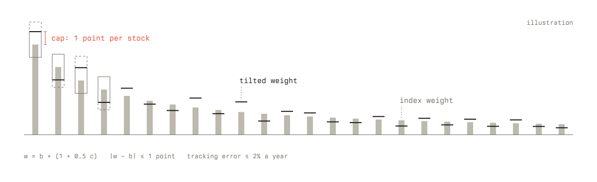
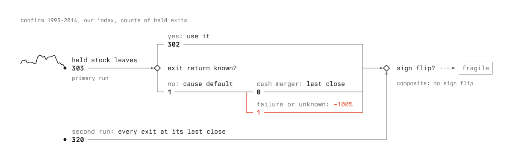
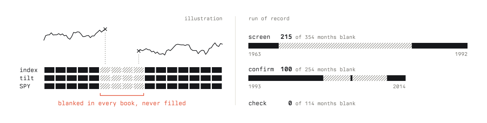
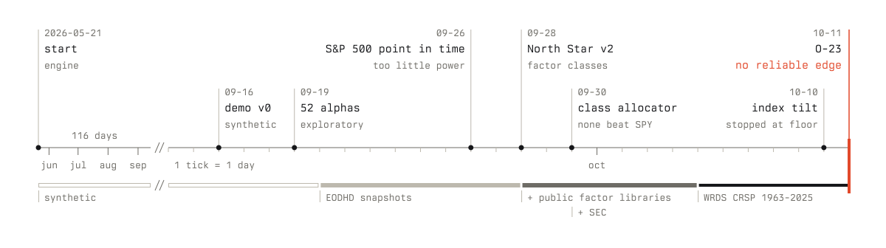

# Research method

[Back to the project page](../README.md)

This page gives the detail behind the project page. The numbers come from the last trial, Milestone 5.5, and its frozen trial file, [`m55_trial_family_v1.json`](preregistrations/m55_trial_family_v1.json). The reports are [`m55_screen_v1.md`](../reports/m55_screen_v1.md) and [`m55_confirm_v1.md`](../reports/m55_confirm_v1.md).

## Time

<picture>
  <source media="(prefers-color-scheme: dark)" srcset="../assets/readme/timing-dark.svg">
  
</picture>

The two books, CW-PIT and the tilted book, rebalance at the last trading row `r` of each month. Cap weights, scores, eligibility, and the risk estimate use rows up to `r-1`. Both books trade at the close of `r` and earn from `r+1`. The [timing contract](signal_execution_timing_contract.md) keeps feature, signal, rebalance, execution, and return dates apart, with tests TIMING-001 to TIMING-014.

Data enters on the day it became known:

- A value known on day `k` is usable from the first trading row after `k`.
- Fundamentals are the first value Compustat published.
- Annual values also wait 6 months after the fiscal year end.
- Share counts are used from 136 calendar days after their start date.

Each layer has a future-perturbation test. It changes inputs from row `r` on and checks that every output up to `r` stays the same. The signal and engine tests compare values exactly. A driver test changes every value after 1992 and checks that the five stage files from coverage to freeze keep the same SHA-256. The engine, signal, loader, and driver frame tests also show that they can fail. In the engine, the same random change made from `r-1` moves the result at `r`. In the signal layer, a change at the last row each rule admits moves the value. In the loader and the driver, the change reaches the later rows.

One declared rule (B2) uses a fact from `r`. A member that leaves at `r` on news first known at `r` has no close at `r`, so it cannot trade. Its held position settles under the exit rule, and both books trade the other members. The rule fired only in the last-close rerun, at 9 screen rebalances and 2 in each later segment.

## The tilt

<picture>
  <source media="(prefers-color-scheme: dark)" srcset="../assets/readme/tilt-dark.svg">
  
</picture>

CW-PIT, short for cap-weighted point-in-time, is the index that the project page calls our index. It holds the S&P 500 members at `r-1` that have a market equity value, at cap weight `b` from that value. A member without a value, about 0.2% of member rebalances, gets zero weight in both books and is counted in the reports. SPY still holds it, so it adds to the gap between CW-PIT and SPY. The tilt moves each weight:

1. Each signal becomes a percentile rank `u` at `r-1`. The score `c` is the mean of `2u - 1` over the signals, so `c` is between -1 and 1.
2. `w = b × (1 + 0.5c)`.
3. No stock moves more than 1 percentage point from `b`. The engine caps, renormalizes, and repeats, and it refuses after 100 passes.
4. The engine scales the tilt down until the expected tracking error against CW-PIT is at most 2% a year. It estimates that from the 252 daily rows that end at `r-1`.

A stock without a full 252-row window, or with too few valid signals, stays at `b`. Ranks are exact fractions, so a score that should be zero is exactly zero.

## Costs

| From | Commission, bp | Spread, bp |
| --- | ---: | ---: |
| 1963-07 (screen only) | 30 | 30 |
| 1975-05 (screen only) | 10 | 30 |
| 1993 | 5 | 20 |
| 2001-04 | 2 | 8 |
| 2007 | 1 | 4 |

Costs are one way, per traded notional. In the confirm and check runs, a trade pays the larger of the schedule spread and the real CRSP closing half-spread from the day before. CW-PIT pays the same rule. An invalid quote keeps its reason, pays the schedule spread, and is counted. In 1993, the CRSP half-spread was above the schedule spread for 83% of the tilt's traded notional. By 2014 the share was 2%. Every result also runs at 2x cost. The books are long only, so there is no borrow cost.

## The sealed year

The seal window is 2019-07-31 to 2020-07-31. In each WRDS table with a price or a return, the rows that touch the window are in a separate folder that no code opens. The loader refuses any path in it and only hashes those files. Tables with no price or return, such as membership, links, share counts, and fundamentals, keep those rows in their main files, and the code reads them. The 2020-07-31 row is sealed too, because its return starts at a close inside the window. The check period steps around 2019-07 to 2021-08. That covers the 13 seal months, 2020-08, whose rebalance row is that sealed row, and 12 warm-up months that rebuild a full 252-day window.

## When a stock disappears

<picture>
  <source media="(prefers-color-scheme: dark)" srcset="../assets/readme/exits-dark.svg">
  
</picture>

In the confirm period, 303 stocks left while the cap-weight book held them. They were bought, they failed, or they left for an unknown reason. Each one settles at its real exit return when the data has one, such as the CRSP delisting return. Otherwise a declared default applies. A cash merger settles at its last close, and a failure or an unknown cause at -100%. Here 302 exits had a real return and 1 took the default. A second loader run settles every exit at its last close. A sign flip between the two runs labels the result fragile. Every composite result kept its sign.

Run 3 met the case the frozen plan had named in advance, a held stock that left the index on a day with no close. The run refused, as the plan required, and amendment 4 added the settlement rule before any result of the next run. A review seat found a look-ahead in the first draft of that rule. The draft set the exit event only if no close came back before the segment end, so it read rows after the exit row. A rule that reads no row after the exit row replaced it.

## Missing data

<picture>
  <source media="(prefers-color-scheme: dark)" srcset="../assets/readme/blanks-dark.svg">
  
</picture>

A missing value stays missing. Each blank signal cell stays blank and holds one of 13 named reasons, such as `no_link`, `not_yet_known`, or `short_history`. Three rules act on missing data, and the reports count each one. A member with no market equity or no price at `r-1` leaves both books, but SPY keeps it. A member with too few valid signals, or with a missing return inside its 252-row window, gets `c = 0` and stays at `b`. The loader also drops a few declared kinds of bad input rows, such as Compustat rows with no known date, and counts each drop.

A held stock across a gap in its CRSP price path blanks every month the gap touches, in every book and the benchmark. Both books and the benchmark lose the same months. The blank set comes from price gaps alone, and the 100 confirm months fall in 2003 to 2011. The rule was set in amendment 1, after the data pull but before any return was computed. It cost 215 screen months and 100 confirm months. It stayed in force through every run, because a change after the results would be a new, counted trial.

## Tests of the result

- **Test A**, the composite tilt. It must beat SPY and CW-PIT at the same time. The p-value is the larger of the two one-sided p-values. Each uses HAC standard errors, which allow for autocorrelation and changing variance in monthly returns. It also needs positive means at 2x cost and no negative check mean.
- **Test B**, a lower-risk version. It stopped before any return, because 64 of the 354 screen rebalances (18.08%) had too short a risk window to set it up, against a limit of 10%.
- **Holm correction** over the two tests. The family kept size 2 after test B stopped, so test A needed p ≤ 0.025.
- **Stop rule.** A confirm composite below 0.300% a year against SPY ends the line.
- **Secondary runs.** Each of the eight signals alone, and a six-signal price baseline, gets a Benjamini-Yekutieli q-value. They are reported beside the primary result.

| Primary run, % a year after costs | vs SPY | vs CW-PIT |
| --- | ---: | ---: |
| Confirm, primary cost | +0.298 | -0.112 |
| Confirm, 2x cost | -0.053 | -0.313 |
| Check, primary cost | +0.484 | +0.324 |

The confirm period is new data for the stocks. The factor ideas come from papers and from Milestone 5 work on these years, so the reports label the run stock-level out-of-sample and factor-level in-sample.

Test A: p = 0.6944, Holm p = 1.0, not met. The stop rule applies. The check means are positive. A second run that settles every exit at its last close gives the same label.

The trial file sized test A in advance. It finds an edge of about 1.08% a year with 80% power. That estimate assumed 254 months, 2% realized tracking error, and a one-sided 5% level before the Holm correction. In the run, blanks left 154 usable months, and the tilt's realized tracking error against CW-PIT was 0.86% a year, so the test saw smaller edges than planned. The confirm t-values were 1.04 against SPY and -0.51 against CW-PIT.

## How we got here

<picture>
  <source media="(prefers-color-scheme: dark)" srcset="../assets/readme/journey-dark.svg">
  
</picture>

| Milestone | What it did | Outcome |
| --- | --- | --- |
| 1 to 3 | Engine, timing contracts, synthetic demos, 52 exploratory alphas | Tools and contracts |
| 4 | First point-in-time S&P 500 tests | Too little data to see the small effects tested |
| 5 | Factor-class allocator on public factor libraries and SEC filings | No tested rule beat SPY after costs |
| 5.5 | Index tilt on CRSP, 1963 to 2025 | Stopped at the floor |

The owner closed the line with decision O-23. With the current data and these factors, we found no reliable edge. The sealed year stays unopened and reserved for a future test.

## Code of the last trial

| File | What it does |
| --- | --- |
| `research/m55_wrds_loader.py` | Builds the engine and signal inputs from the WRDS files and refuses a file whose SHA-256 does not match |
| `research/m55_signals.py` | The eight point-in-time candidate signals S1 to S8 |
| `research/m55_index_tilt.py` | CW-PIT, the tilt, and the lower-risk book, on frames that the driver passes in |
| `research/m55_criteria.py` | The screen, shortlist, success, and stop decisions, on return series that the driver passes in |
| `research/m55_driver.py` | Runs the frozen trial file in seven hash-chained stages |
| `research/m55_screen_report.py`, `research/m55_confirm_report.py` | Write the public reports, aggregates only |

## Accounting in the core engine

| Contract | Current behavior |
| --- | --- |
| Signal availability | Default `signal_lag_periods=1` selects the previous available signal row |
| Return timing | Weights set on date `t` earn returns from the next available price row |
| Holdings | Post-trade weights on rebalance dates; drifted closing weights between rebalances |
| Trades | Signed target weights minus drifted pre-trade weights on rebalance dates |
| Turnover | Sum of absolute signed trades under the undivided convention |
| Costs | Basis points on turnover, charged after returns on the beginning-period return basis |
| Halts | By default (`missing_price_policy="raise"`), a held stock with no valid close stops the run. Milestone 5.5 uses `halt_gap_return_v1`: the stock keeps its last close as its mark, and only the free part of the book trades |

## Verify

```bash
python -m pytest -q
python -m ruff check .
python -m compileall -q src research tests lean
git diff --check
```

## Records

[North Star](north_star.md) · [Roadmap](current_roadmap.md) · [Decision log](decision_log.md) · [Engineering log](engineering_log.md) · [Project specification](../PROJECT_SPEC.md) · [Experiment registry](../reports/experiment_registry.md) · [Handoff](current_handoff.md)
